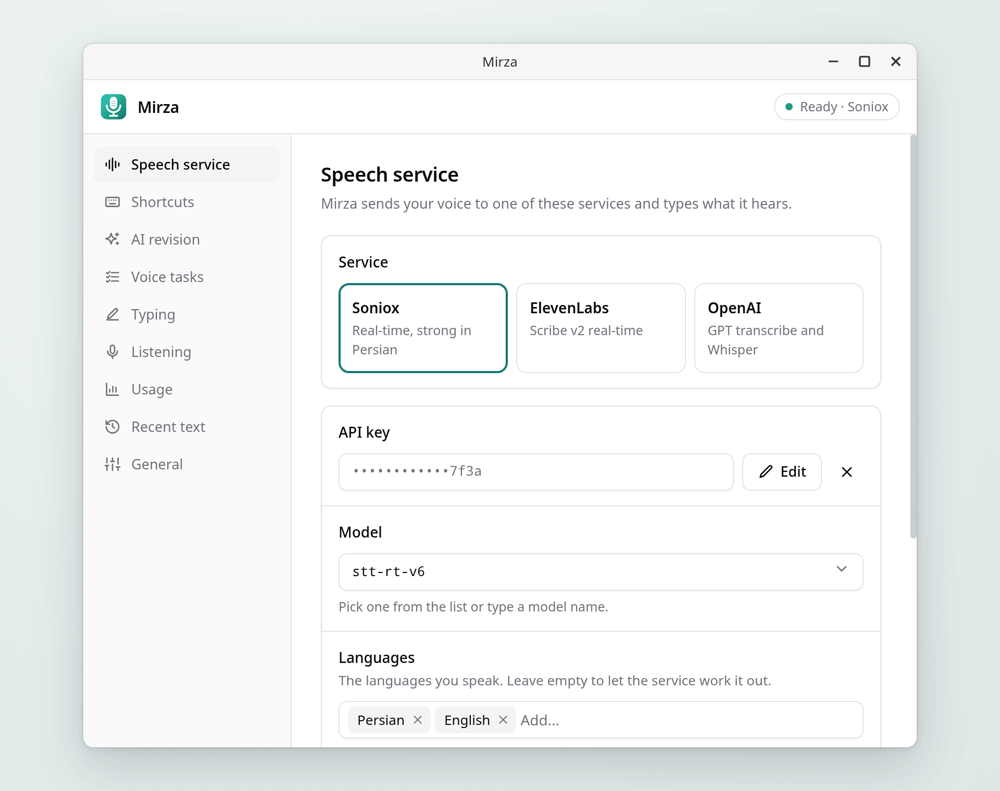
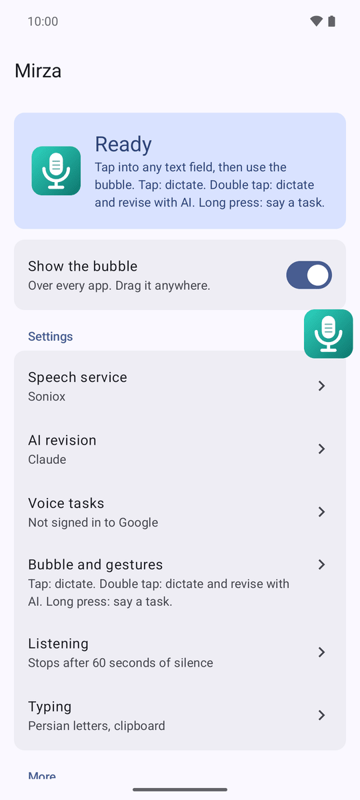
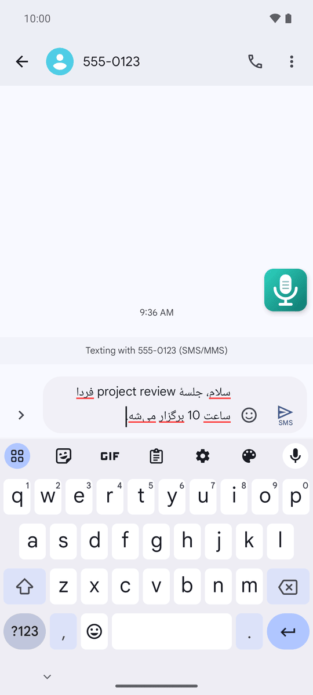
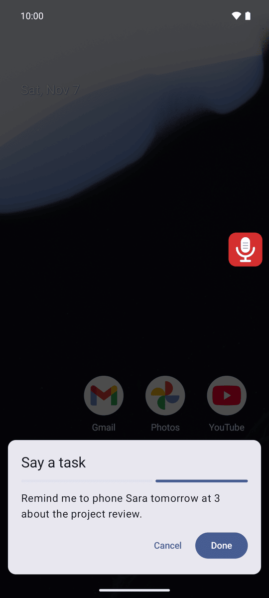

<p align="center"></p>

<h1 align="center">Mirza — voice typing for any app</h1>

<p align="center">
Press a shortcut, speak, and your words are typed wherever your cursor is.<br>
Open-source speech-to-text dictation for <b>Linux, Windows, macOS and Android</b>.
</p>

<p align="center">
<a href="https://github.com/erfnemati/mirza/releases/latest"></a>
<a href="https://github.com/erfnemati/mirza/actions/workflows/ci.yml"></a>

</p>

Mirza (from «میرزا بنویس», "Mirza, write this down") is a small tray app that
turns your voice into text in any program: your editor, browser, chat apps,
email, terminal. It is very light: about 9 MB of memory while it waits.

<p align="center"></p>

**What it costs:** the app is free and open source, but the speech
recognition runs on a cloud service (**Soniox**, **OpenAI** or **ElevenLabs**)
that you pay for yourself, with your own API key. You pay the service for the
minutes you dictate. With Soniox that's roughly $0.12–0.15 per hour of speech
(2026 prices; check the service's pricing page). Mirza shows what you've spent
this month.

## Why use it

- **Typing is slow or painful for you.** Say it instead: long messages, notes,
  emails, code comments.
- **Talk to AI tools faster.** Dictate a long, messy prompt, then let ChatGPT,
  Claude or any LLM clean it up and structure it.
- **You write in more than one language.** Mix Persian (Farsi) and English in
  the same sentence; Mirza types both correctly, half-spaces included.
- **You want dictation that works everywhere.** Not just in one app or browser:
  Wayland and X11 on Linux (KDE Plasma, GNOME), Windows, macOS, and Android
  phones.

It is an open-source alternative to tools like Wispr Flow, Superwhisper, and
the built-in voice typing of Windows and macOS.

## Features

- **Global shortcuts.** Press to start and stop, or hold to talk. A single
  key like Right Ctrl works on Windows and macOS.
- **Live, real-time transcription**, typed as you speak each phrase.
- **Services:** Soniox, OpenAI (GPT transcribe, Whisper) or ElevenLabs Scribe.
  Switch between them from the tray.
- **Recognition help:** language hints, and custom words for names and jargon.
- **AI revision (optional):** a separate shortcut sends the text through an AI
  model (Claude, OpenAI, Gemini, OpenRouter or your own local server) that
  drops fillers and repeats, keeps your last correction, and fixes punctuation
  and half-spaces, without translating. It can also polish the wording, lightly
  or fully, with switches for plain words, formal Persian and digits. If the AI
  fails, what you said is typed as is. See [docs/ai-revision.md](docs/ai-revision.md).
- **Voice tasks (optional):** a shortcut of its own (a gesture on the phone).
  Say a task and Mirza saves it to Google Tasks with a short title, in the
  list that fits what you said. A task with a clock time also becomes a Google
  Calendar event, so Google reminds you. A notification has **Undo** and
  **Edit**, and a task said offline waits and is saved once Google can be
  reached. See [docs/voice-tasks.md](docs/voice-tasks.md).
- **Tray and settings:** a tray icon that shows when it's recording, and a
  settings window with your usage and spend.
- **Pauses** if you switch windows mid-sentence, so text never lands in the
  wrong app.
- **A short sound** when it starts and stops listening, so you don't have to
  look.
- **Tells you about new versions** (one check a day; can be turned off).
- **Proxy support** (HTTP and SOCKS5). On Windows and macOS it uses the
  system proxy that VPN apps set, unless you enter another one.

**On Android**, Mirza is a small bubble over every app; you choose its size,
its opacity and whether it shows the logo. Tap it and speak, and the text goes
into the field you are in, in any app. A double tap, a long press, volume down
or Android's accessibility button can start dictation, dictation revised by AI,
or a voice task. On the lock screen Mirza types nothing: a task you say there
waits on the phone until you unlock it and confirm the task.

<p align="center">



</p>

## Install

Download the file for your system from the
**[latest release](https://github.com/erfnemati/mirza/releases/latest)**.

### Linux

| Distribution | File | Command |
|---|---|---|
| Debian, Ubuntu, Mint | `mirza_<version>_amd64.deb` (or `arm64`) | `sudo apt install ./mirza_*.deb` |
| Fedora, openSUSE | `mirza-<version>.x86_64.rpm` (or `aarch64`) | `sudo dnf install ./mirza-*.rpm` |
| Others | `mirza-<version>-linux-<arch>.tar.gz` | unpack, then run `./install.sh` |

Log out and back in once (so Mirza may use its virtual keyboard), then start
**Mirza** from your app menu.

Global shortcuts need KDE Plasma 6 or GNOME 48 and later. On other desktops,
bind the command `mirza toggle` to a key in your keyboard settings.

### Windows

Run `Mirza-<version>-windows-x64-setup.exe`. It installs for your user only,
without administrator rights.

The installer isn't signed yet, so Windows SmartScreen may warn you: click
**More info**, then **Run anyway**.

### macOS

Open `Mirza-<version>-macos-universal.dmg` (Apple Silicon and Intel) and drag
Mirza to Applications. The first time you open it:

1. Go to **System Settings → Privacy & Security** and click **Open Anyway**.
2. Allow **Microphone** when asked.
3. Allow **Accessibility**, so Mirza can see its shortcut and type.

### Android

Download `Mirza-<version>-android.apk` on the phone (Android 10 or newer) and
open it. Mirza isn't in the Play Store, so Play Protect may warn you, and
Android may call its accessibility switch a "restricted setting" until you
allow it. The [Android install guide](docs/install-android.md) walks through
both, and through the extra steps on Xiaomi phones.

## Getting started

1. Click the Mirza icon in the tray to open the settings.
2. Choose a service and paste its API key. Get one here:
   [Soniox](https://console.soniox.com),
   [OpenAI](https://platform.openai.com/api-keys) or
   [ElevenLabs](https://elevenlabs.io/app/settings/api-keys).
3. Press **Ctrl+Alt+H** in any app and start talking; press it again to stop.
   Or hold **Ctrl+Alt+J** while you talk. You can change both under
   **Shortcuts**.
4. Optional: turn on **AI revision** with a key for an AI provider
   ([guide](docs/ai-revision.md)), and set up **Voice tasks** once with your
   Google account ([guide](docs/voice-tasks.md)).

## Privacy

- **When it listens:** audio is recorded only while you dictate or say a task.
- **Where audio goes:** only to the speech service you picked.
- **AI revision**, if you turn it on, sends the text (not the audio) to the AI
  provider you picked, or to your own server.
- **Voice tasks**, if you set them up, send the text to the AI provider you
  chose for tasks, with the names of your task lists and the current date and
  time, and then the task to your Google account (Google Tasks, and Google
  Calendar for a task with a time).
- **Your API keys** and the Google sign-in stay on your computer, readable only
  by you. On the phone they are in the app's private storage; the Google
  sign-in itself is kept by Google Play services.
- **Your text:** on the computer, dictated text is kept in memory for the
  "Recent text" list and never saved to disk. Voice tasks are different: each
  task is saved in Mirza's data folder until Google has it, and the last 20
  saved tasks stay there for Undo and Edit. On the phone, "Recent text", tasks
  that wait and the lock-screen queue are kept in the app's private storage,
  left out of backups; "Recent text" can be turned off. A task said on the lock
  screen is sent nowhere until you unlock the phone and confirm it.

## Build from source

Needs [Rust](https://rustup.rs). On Linux, you also need the WebKitGTK
development files:

```sh
sudo apt install libwebkit2gtk-4.1-dev libgtk-3-dev librsvg2-dev   # Debian/Ubuntu
cargo build --release -p mirza -p mirza-panel
scripts/install-linux.sh    # optional: install for your user
```

The Android app is in `android/`; see [docs/android-app.md](docs/android-app.md).

Contributions are welcome. See [docs/testing.md](docs/testing.md) for a manual
test checklist.

## License

[MIT](LICENSE)
